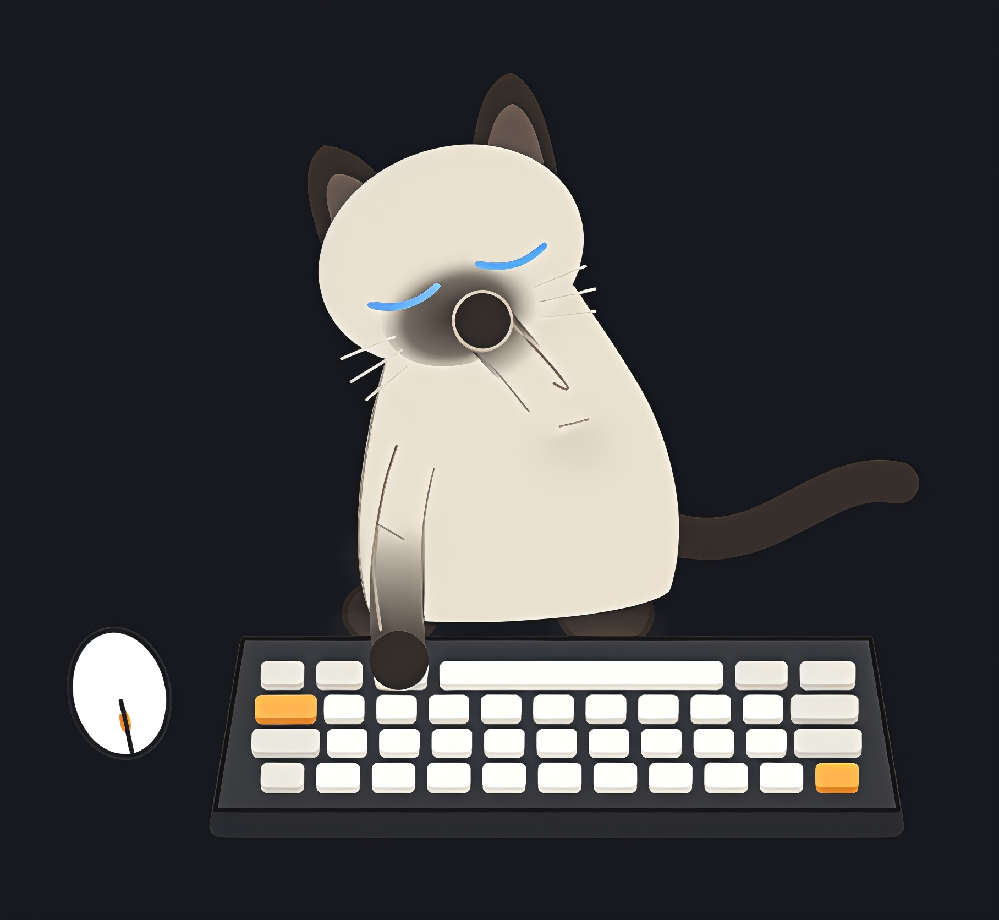

# elChambeador

<p align="center">
  
</p>

<p align="center">
  <a href="https://v2.tauri.app/">
    
  </a>
  <a href="https://preactjs.com/">
    
  </a>
  <a href="https://animejs.com/">
    
  </a>
  <a href="https://www.typescriptlang.org/">
    
  </a>
  <a href="https://vite.dev/">
    
  </a>
  <a href="https://www.rust-lang.org/">
    
  </a>
  <a href="https://bun.sh/">
    
  </a>
</p>

<p align="center">
  <strong>Tu compañero de escritorio para acompañar cada jornada de trabajo.</strong>
</p>

**elChambeador** es una aplicación de escritorio interactiva construida con **Tauri 2, Preact, TypeScript, Vite, anime.js y Rust**.

La aplicación presenta una escena SVG animada de un gato de escritorio (`CatDeskScene`) que acompaña tu jornada reaccionando en tiempo real a la actividad global del sistema, incluyendo teclado y ratón.

El gato cuenta con un repertorio de comportamientos autónomos, animaciones reactivas e interacciones visuales. Cuando detecta un periodo prolongado de inactividad, entra en modo siesta y despierta automáticamente al detectar nueva actividad.

---

## Descarga e instalación

Descarga la versión más reciente desde [**Releases**](../../releases).

Selecciona el instalador correspondiente a tu sistema operativo:

| Sistema operativo | Formato |
| :--- | :--- |
| Windows | `.msi` o `-setup.exe` |
| macOS | `.dmg` (Apple Silicon / Intel) |
| Linux | `.AppImage` o `.deb` |

> Consulta los archivos disponibles en la sección **Assets** de cada lanzamiento.

---

## Características principales

### Seguimiento global de actividad

El hook `useGlobalInput` recibe eventos globales de teclado y ratón emitidos desde el backend de Tauri:

- `input-key`: seguimiento de pulsaciones de teclado.
- `input-mouse`: seguimiento de movimientos y botones del ratón.
- Posición normalizada del cursor.
- Estado de las teclas y botones activos.
- Registro de actividad para controlar los periodos de inactividad.

### Escena interactiva: CatDeskScene

Una escena SVG animada que responde a la actividad del usuario mediante diferentes comportamientos y animaciones.

**Animaciones reactivas:**

- Seguimiento continuo del puntero mediante movimientos de ojos y cabeza.
- Respiración suave del torso.
- Cinemática de patas articuladas sobre el teclado.
- Interacción independiente con teclado y ratón, evitando solapamientos.
- Teclas flotantes que reaccionan a la escritura.
- Velocidad de movimiento de la cola adaptativa al ritmo de escritura.

**Interacciones directas:**

- Caricias sobre la cabeza del gato, con cierre de ojos y corazones animados.
- Respuestas especiales a las teclas `Escape`, `Enter`, `Backspace` y `Space`.
- Reacciones visuales a la actividad del teclado y ratón.

**Comportamientos autónomos:**

El gato dispone de siete animaciones de reposo seleccionadas mediante un sistema *shuffle bag*, evitando repeticiones consecutivas innecesarias.

| Animación | Comportamiento |
| :--- | :--- |
| `lookAround` | Mira alrededor con curiosidad. |
| `groom` | Se acicala sincronizando cabeza, lengua y pata. |
| `blink` | Parpadea de forma natural. |
| `earTwitch` | Sacude las orejas. |
| `stretch` | Realiza un estiramiento. |
| `curiousTilt` | Inclina la cabeza con curiosidad. |
| `tailFlick` | Mueve la cola bruscamente. |

### Modo descanso y reactivación

Cuando no se detecta actividad durante 60 segundos, el gato entra automáticamente en modo dormido.

- Tiempo de espera configurable mediante `SLEEP_TIMEOUT_MS = 60000`.
- Animaciones de reposo adaptadas al estado de sueño.
- Reposo de las patas y del ratón.
- Despertar inmediato al detectar movimiento del ratón o pulsaciones de teclado.

### Personalización visual y sonora

Adapta la apariencia y el comportamiento del escritorio:

| Opción | Configuración |
| :--- | :--- |
| Pelajes | Siamese, White, Black, Orange, Gray y Calico. |
| Tema del teclado | Dark / Light. |
| Escala | Tamaño visual ajustable. |
| Teclas especiales | Resaltado visual configurable. |
| Efectos de sonido | Sonidos mecánicos opcionales mediante `deskAudio`. |

### Integración nativa con el escritorio

El backend desarrollado en Rust (`src-tauri`) se encarga de la integración con el sistema operativo:

- Gestión de ventanas transparentes mediante Tauri v2.
- Definición y gestión de *hitboxes* interactivos.
- Captura global de eventos de teclado y ratón mediante `rdev`.
- Comunicación de eventos entre Rust y Preact.

---

## Stack tecnológico

| Tecnología | Función |
| :--- | :--- |
| [Tauri 2](https://v2.tauri.app/) | Framework de escritorio. |
| [Preact](https://preactjs.com/) | Interfaz de usuario. |
| [TypeScript](https://www.typescriptlang.org/) | Tipado estático. |
| [Vite](https://vite.dev/) | Herramientas de desarrollo y compilación. |
| [anime.js](https://animejs.com/) | Animaciones. |
| [Rust](https://www.rust-lang.org/) | Backend nativo. |
| [rdev](https://github.com/Narsil/rdev) | Captura global de entrada. |
| [Bun](https://bun.sh/) | Runtime y gestor de paquetes. |

---

## Requisitos previos

Antes de comenzar, asegúrate de tener instaladas las siguientes herramientas:

- [Bun](https://bun.sh/).
- [Rust](https://www.rust-lang.org/) y Cargo.
- Dependencias del sistema necesarias para compilar aplicaciones con [Tauri 2](https://v2.tauri.app/start/prerequisites/).

Consulta la documentación oficial de Tauri para conocer los requisitos específicos de tu sistema operativo.

---

## Desarrollo

### 1. Clonar el repositorio

```bash
git clone <repository-url>
cd elChambeador
```

### 2. Instalar dependencias

```bash
bun install
```

### 3. Iniciar el entorno de desarrollo

Ejecuta la aplicación en modo desarrollo:

```bash
bun run tauri dev
```

Esto inicia el entorno de Vite junto con la aplicación de escritorio de Tauri.

### 4. Compilar para producción

Para generar los instaladores de escritorio:

```bash
bun run tauri build
```

Los artefactos generados dependerán de la plataforma y de la configuración de compilación de Tauri.

---

## Estructura del proyecto

Los principales componentes y módulos de la aplicación son:

| Archivo | Responsabilidad |
| :--- | :--- |
| `src/hooks/useGlobalInput.tsx` | Suscripción a eventos `input-key` e `input-mouse` y normalización del estado de entrada. |
| `src/components/CatDeskScene.tsx` | Escena SVG interactiva, cinemática de extremidades, animaciones autónomas, caricias y modo dormido. |
| `src/utils/deskAudio.ts` | Síntesis y reproducción de sonidos mecánicos de teclado y clics de ratón. |
| `src-tauri/src/lib.rs` | Captura global de entrada y gestión de ventana e interacción mediante Rust. |

---

## Entorno de desarrollo recomendado

Para trabajar en el proyecto se recomienda:

- [Visual Studio Code](https://code.visualstudio.com/).
- [Tauri VS Code Extension](https://marketplace.visualstudio.com/items?itemName=tauri-apps.tauri-vscode).
- [rust-analyzer](https://marketplace.visualstudio.com/items?itemName=rust-lang.rust-analyzer).

---

## Apoyar el proyecto

Si elChambeador te resulta útil y quieres contribuir a su mantenimiento y desarrollo, puedes invitarme a un café mediante PayPal.

<p align="center">
  <a href="https://paypal.me/SergioCampbelldev">
    
  </a>
</p>

---

<p align="center">
  Hecho con dedicación, código y un gato que nunca deja de trabajar.
</p>

<p align="center">
  <strong>elChambeador</strong>
</p>
